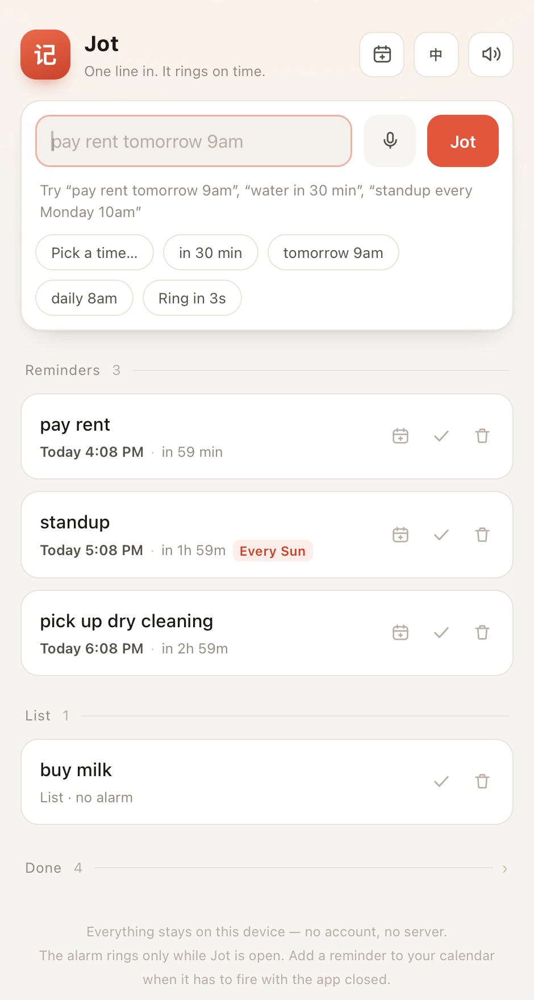
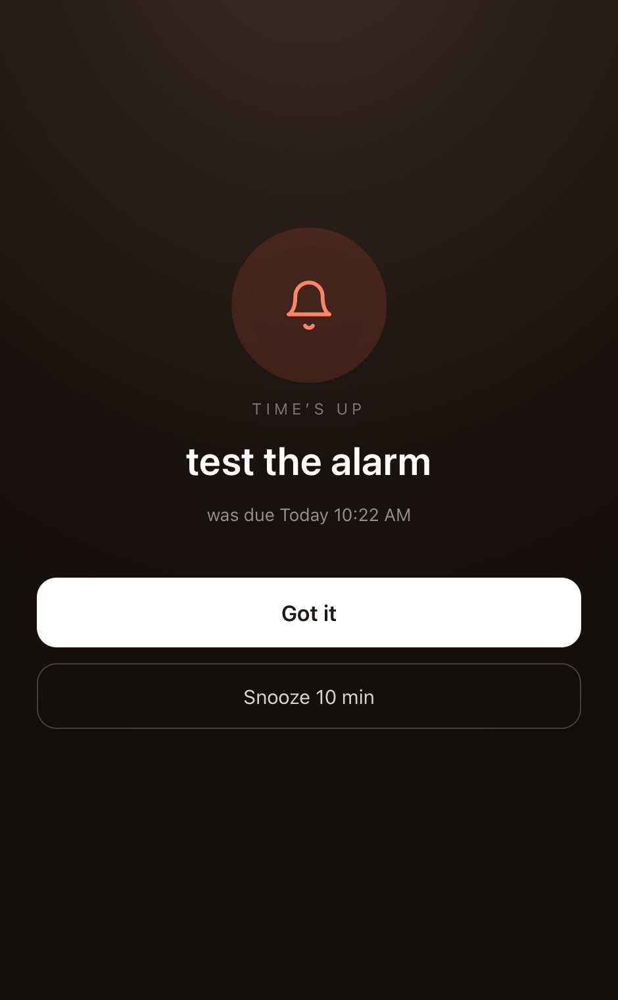
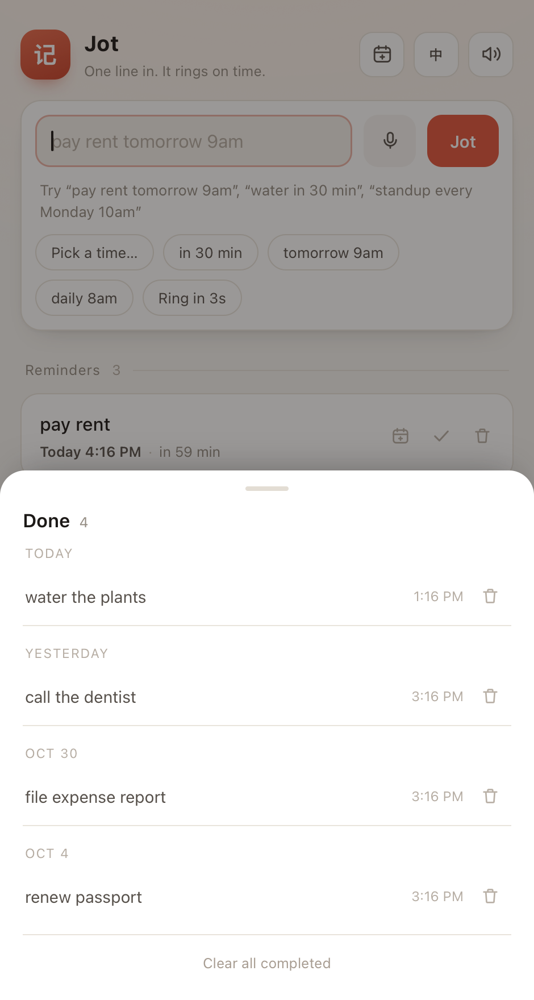

# Jot · 记一下

> Type one line. It rings on time.

**[中文说明](README.zh-CN.md)**



Jot is a reminder app with one input box. You type a sentence the way you'd say it —
`pay rent tomorrow 9am`, `water in 30 min`, `standup every Monday 10am` — and it figures
out the time itself. No date pickers, no forms, no account, no server.

The whole app is a single `index.html`. Open the file and it works.

```
open index.html          # that's the install
```

## What it does

- **One line in.** Natural-language time parsing in English and Chinese, with a live preview
  under the box so you can see what it understood *before* you commit.
- **Two shelves.** Anything with a time goes to **Reminders** with a countdown; anything without
  goes to **List** and never interrupts you.
- **A real alarm.** At the due moment the screen goes dark and a synthesized chime loops until you
  hit **Got it** (or press `Esc`). Snooze is one tap.
- **Repeats.** Daily / weekly / monthly, rolling forward automatically after each acknowledgement.
- **Never loses an item.** Missed reminders fire the next time you open the app, one queue at a time.
- **Add to Calendar.** Exports a `.ics` with an alarm, so the reminder still fires when Jot is closed.
- **Done stays out of the way.** Completed items collapse into a single `Done · 128 ›` line and open a
  day-grouped archive where you can delete one by one or clear the lot (undo included).
- **Two languages, English by default.** Toggle top-right; the choice is remembered.
- **Installable.** Works offline as a PWA, and ships with a tiny native macOS wrapper.

## What it understands

| English | 中文 | Result |
| --- | --- | --- |
| `pay rent tomorrow 9am` | `明天 9 点 交房租` | tomorrow 09:00 |
| `water in 30 min` | `30 分钟后 喝水` | now + 30 minutes |
| `standup every Monday 10am` | `每周一 10 点 例会` | weekly, Monday 10:00 |
| `take meds every day 8am` | `每天 8 点 吃药` | daily 08:00 |
| `dentist on friday 3pm` | `下周三 晚 8 点 健身` | that weekday, given time |
| `flight Oct 31 3pm` | `10 月 31 日下午 3 点 交材料` | absolute date + 12h conversion |
| `every month on the 5th pay the bill` | `每月 5 号 还信用卡` | monthly on the 5th |
| `buy milk` | `买牛奶` | no time → List, no alarm |

Rules: with no am/pm, `9` stays 9:00 and `8pm` converts; a date with no time defaults to 09:00;
if the computed moment has already passed, it rolls to the next occurrence (or to tomorrow).

Parsers are tried in both languages, so typing Chinese while the UI is English still works.

## Add to Calendar (the "closed app" workaround)

A web page can only ring while it's open — that's a platform fact, not a bug. For the reminders
that must survive a closed window, every timed row has a calendar button:



It writes an `.ics` with a `VALARM` at the due time (plus `RRULE` for repeats). Import it once and
**Calendar / Outlook does the ringing**, on any device, whether Jot is running or not.
The calendar button in the header (`Add all reminders to Calendar`) exports the whole list at once.

## Done: collapsed, archived, clearable

Ticking a reminder off moves it to `Done`. That row never grows: the list shows one line —
`Done 128 ›` — no matter how much history piles up, so the main screen stays the same length forever.



Tapping it opens the archive, grouped by day (`Today`, `Yesterday`, `Oct 30`, …). From there:

- **delete** a single entry with its trash button (undoable);
- **Clear all completed** wipes the archive in one go, with a 5-second undo in the toast.

There is no automatic expiry: nothing is deleted without you asking. The one exception is honest and
loud — if `localStorage` runs out of quota (~5 MB, several thousand items), Jot trims the oldest
completed entries until the newest item fits, and tells you how many it dropped. Previously the write
just failed silently, which meant the newest jot never reached disk.

Above 300 archived items the sheet renders the most recent 300 and says so.

## Platforms

| Where | How | Notes |
| --- | --- | --- |
| Any browser | open `index.html` | zero install; the alarm needs the tab open |
| macOS / Windows / Linux | serve over http(s) and **Install app** (Chrome, Edge, Safari 17+) | real window, own icon, works offline |
| macOS | `./mac/build.sh` → `dist/Jot.app` | native WKWebView shell, ~1 MB — see [docs/packaging-macos.md](docs/packaging-macos.md) |
| iOS / Android | Add to Home Screen | standalone, works offline |
| Windows `.exe` / Linux binary | not shipped | see [docs/packaging-desktop.md](docs/packaging-desktop.md) |

## Project layout

```
index.html              the entire app (UI, parser, alarm, i18n, .ics export)
manifest.webmanifest    PWA metadata
sw.js                   offline cache (network-first)
icons/                  generated PWA icons
mac/                    macOS wrapper: Swift + WKWebView
  Jot.swift             window, menu, jot:// scheme, calendar bridge
  Info.plist
  build.sh              builds dist/Jot.app
tools/
  icon.swift            renders the app icon at any size
  gen-icons.sh          regenerates icons/
test/
  parser.test.js        parser cases, no dependencies
docs/                   screenshots and notes
```

## Develop

```bash
node test/parser.test.js    # parser cases (EN + ZH + mixed)
./tools/gen-icons.sh        # regenerate icons/ (macOS: swiftc + sips)
./mac/build.sh              # rebuild the macOS app
```

`index.html` needs no build step: edit it, reload the browser. The macOS shell embeds *a copy*, so
re-run `mac/build.sh` after editing.

Adding a language takes an `I18N` block, a parser branch (the region between the `#region parser`
markers — which is exactly what the test file extracts), and a date-format branch in `dayLabel` /
`remainLabel` / `repeatTag`.

## Known limits

- **The alarm only rings while the app is open.** The calendar export is the honest workaround;
  a background daemon or a native notification layer is not implemented.
- Data lives in `localStorage` on one device only. Export/import is on the roadmap.
- Completed items are never deleted automatically; if the storage quota is reached, the oldest ones
  are trimmed (with a notice) so the newest change still survives.
- System notifications are best-effort: browsers require permission, and the macOS shell has none
  (the full-screen alarm replaces them there).
- Time parsing is deliberately shallow. If it can't find a time, the item goes to the list
  instead of guessing.

## Roadmap

- [ ] JSON import/export
- [ ] Notification triggers (Service Worker `showTrigger`, Chromium only) for closed-tab alarms
- [ ] EventKit in the macOS shell — optional polish, the `.ics` path is two clicks today
- [ ] More languages (the i18n shape is ready)
- [ ] Tauri build for Windows/Linux

## License

MIT — see [LICENSE](LICENSE). The logomark 记 ("to note down") doubles as the app icon.
