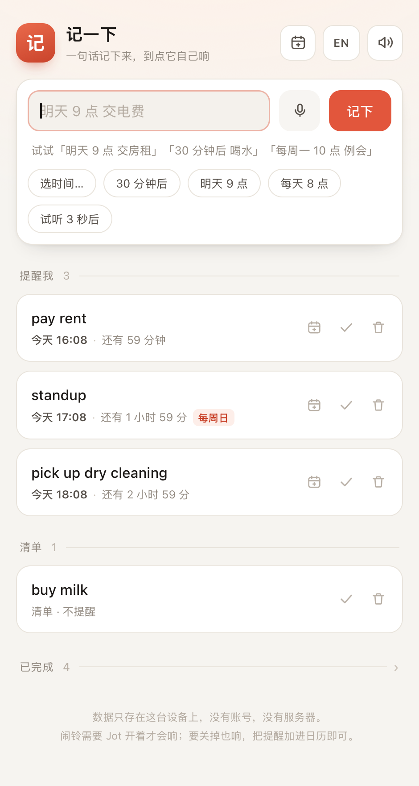
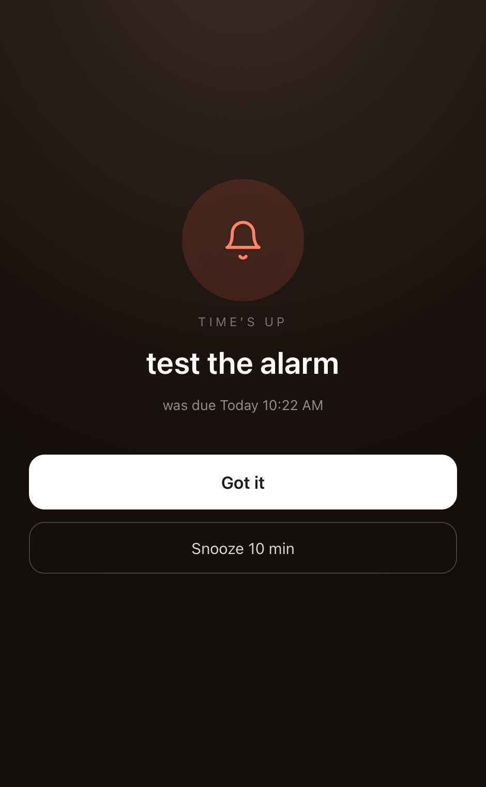
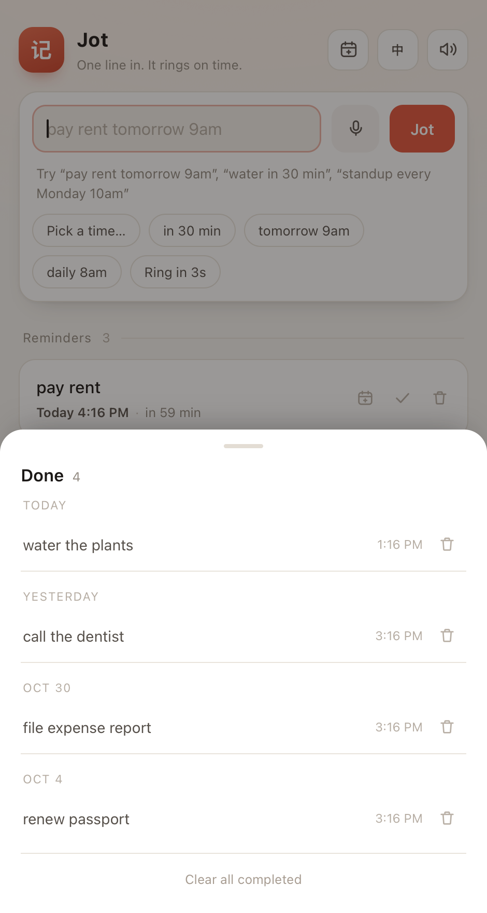

# Jot · 记一下

> 一句话记下来，到点它自己响。

**[English](README.md)**



只有一个输入框的提醒工具。你像说话一样打一句——`明天 9 点 交房租`、`30 分钟后 喝水`、
`每周一 10 点 例会`——时间由它自己算。没有表单、没有账号、没有服务器。

整个应用就是一个 `index.html`，双击打开就能用：

```
open index.html          # 这就是安装
```

## 能做什么

- **一句话输入**：中英文自然语言解析，输入时实时预览识别结果，提交前就能发现识别错了。
- **两种收纳**：带时间的进「提醒我」，带倒计时；不带时间的进「清单」，不打扰。
- **真的会响**：到点全屏变暗 + 循环铃声（Web Audio 合成，无需音频文件），点「知道了」或按 `Esc`
  才停；也能「10 分钟后再响」。
- **周期任务**：每天 / 每周 / 每月，确认后自动排下一次。
- **一条不丢**：关掉再打开，错过的一次一条地补响。
- **加入日历**：导出带闹铃的 `.ics`，Jot 关掉也会由系统日历提醒。
- **完成不碍事**：完成的条目收成一行「已完成 128 ›」，点开是按天分组的归档，可以单条删，也可以一键清空（可撤销）。
- **中英双语，默认英文**：右上角一键切换，选择会被记住。
- **可安装**：PWA 离线可用，另附一个 1MB 的 macOS 原生外壳。

## 认识哪些说法

| 中文 | English | 结果 |
| --- | --- | --- |
| `明天 9 点 交房租` | `pay rent tomorrow 9am` | 明天 09:00 |
| `30 分钟后 喝水` | `water in 30 min` | 当前时刻 +30 分钟 |
| `每周一 10 点 例会` | `standup every Monday 10am` | 每周一 10:00 |
| `每天 8 点 吃药` | `take meds every day 8am` | 每天 08:00 |
| `下周三 晚 8 点 健身` | `dentist on friday 3pm` | 指定星期 + 时间 |
| `10 月 31 日下午 3 点 交材料` | `flight Oct 31 3pm` | 绝对日期 + 上下午换算 |
| `每月 5 号 还信用卡` | `every month on the 5th pay the bill` | 每月 5 号 |
| `买牛奶` | `buy milk` | 无时间 → 清单，不提醒 |

规则：没写上午/下午时 `9` 就是 9:00，写了 `8pm` 会换算；只写日期默认 09:00；算出来的时刻已经过了，
就顺延到下一次（或明天）。中英两套解析都会试一遍，所以英文界面里打中文也能认。

## 加入日历（「关掉也响」的办法）

网页只能开着才响，这是平台限制。对「必须关掉也响」的提醒，每行有个日历按钮：



它会生成一个带 `VALARM` 的 `.ics`（周期任务还带 `RRULE`）。导入一次，之后就由**日历 / Outlook 负责提醒**，
任何设备上都有效，Jot 开不开都无所谓。页首右上角的日历按钮 =「把提醒全部加进日历」，一次导出整张清单。

## 已完成：折叠、归档、可清空

勾掉的条目会进「已完成」。这一块**永远不会变长**：主界面上只占一行 `已完成 128 ›`，
不管攒了多少历史，页面长度都是固定的，所以页首的操作按钮也不会被挤到看不见的地方。



点开就是归档面板，按天分组（`今天`、`昨天`、`10 月 30 日`……）。里面可以：

- 单条**删除**（可撤销）；
- **清空已完成**：一次清完，底部提示条里有 5 秒「撤销」。

没有自动过期：你不点头，它不删东西。唯一的例外说得明明白白——`localStorage` 配额（约 5MB，
几千条）写满时，会从最老的已完成记录开始裁，直到最新一条能存下，并告诉你裁了几条。
以前这种写入是**静默失败**的，等于最新记的那条根本没落盘。

归档超过 300 条时，面板只渲染最近 300 条，并注明总数。

## 各平台怎么跑

| 平台 | 怎么用 | 说明 |
| --- | --- | --- |
| 任意浏览器 | 打开 `index.html` | 零安装；闹铃需要页面开着 |
| macOS / Windows / Linux | 用 http(s) 提供页面后「安装应用」（Chrome、Edge、Safari 17+） | 独立窗口、独立图标、离线可用 |
| macOS | `./mac/build.sh` → `dist/Jot.app` | WKWebView 原生外壳，约 1MB |
| iOS / Android | 添加到主屏幕 | 独立窗口、离线可用 |
| Windows `.exe` / Linux 可执行文件 | 未随仓库提供 | 见 [docs/packaging-desktop.md](docs/packaging-desktop.md)，Tauri 是最短路径 |

## 目录

```
index.html              全部代码（界面、解析、闹铃、i18n、.ics 导出）
manifest.webmanifest    PWA 元信息
sw.js                   离线缓存（network-first）
icons/                  生成的 PWA 图标
mac/                    macOS 外壳（Swift + WKWebView）
tools/                  图标生成
test/parser.test.js     解析器用例（零依赖）
docs/                   截图与说明
```

## 开发

```bash
node test/parser.test.js    # 解析器用例（英文 + 中文 + 混输）
./tools/gen-icons.sh        # 重新生成 icons/（macOS，用 swiftc + sips）
./mac/build.sh              # 重新打包 macOS 应用
```

`index.html` 没有构建步骤，改完刷新浏览器即可。macOS 外壳里跑的是**打包进去的副本**，
所以改完要重新跑一次 `mac/build.sh`。

加一门语言 = 往 `I18N` 里加一块字典、给解析器加一支（`#region parser` 标记之间的代码，
正是测试文件抽出来跑的那段）、再补上 `dayLabel` / `remainLabel` / `repeatTag` 里的日期分支。

## 已知限制

- **应用关掉就不响。** 加入日历是目前最诚实的解法；后台常驻进程、原生通知层都还没做。
- 数据只存在本机 `localStorage`，导入导出还在路线图里。
- 已完成条目不会自动删除；配额写满时会裁掉最老的几条（有提示），保证最新改动能存下。
- 系统通知是尽力而为：浏览器要授权，macOS 外壳里没有（用全屏闹铃替代）。
- 时间解析刻意做得浅，认不出来就进清单，不硬猜。

## 路线图

- [ ] JSON 导入 / 导出
- [ ] Service Worker `showTrigger` 定时通知（仅 Chromium）让关页也能响
- [ ] macOS 外壳接 EventKit（可选打磨，现在 .ics 是两次点击）
- [ ] 更多语言
- [ ] Tauri 打包 Windows / Linux 版本

## 许可

MIT，见 [LICENSE](LICENSE)。图标上的「记」既是品牌标记，也是应用图标。
